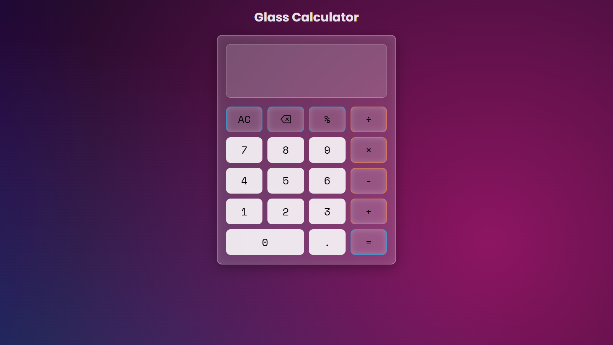

# 🧮 Glass Calculator

A beautifully designed, fully functional web-based calculator featuring a modern **Glassmorphism** user interface. This project was built to practice DOM manipulation, JavaScript logic, and advanced CSS styling techniques.

## ✨ Features

* **Glassmorphism UI:** Built with translucent backgrounds, frosted glass effects (`backdrop-filter`), and subtle borders to create a sleek, modern look.
* **Animated Background:** Features a custom CSS `@keyframes` animation with moving ambient radial gradients.
* **Dynamic Display:** The calculator features a dual-display system. It shows your current equation on top and automatically calculates the live answer on the bottom as you type.
* **Full Functionality:** * Standard arithmetic operations (`+`, `-`, `×`, `÷`)
  * Percentage calculations (`%`)
  * Decimal support with logic to prevent multiple/invalid decimal placements
  * Backspace and All Clear (`AC`) functionality

## 🛠️ Tech Stack

* **HTML5:** Semantic structure and layout.
* **CSS3:** Advanced styling, CSS Grid for the button layout, Flexbox, keyframe animations, and custom hover states.
* **JavaScript (Vanilla):** Event listeners, error handling (`try/catch`), string parsing, and calculation logic.

## 🚀 What I Learned

While building this project, I strengthened my skills in:
* **CSS Grid & Flexbox:** Precisely aligning the calculator buttons and display areas.
* **Event Delegation:** Handling clicks for all calculator buttons efficiently.
* **Edge-case Logic:** Writing JavaScript to handle weird user inputs (like pressing multiple decimals or operators in a row).

## 👤 Author

**Hanzala Bhoraniya**
* Part of the Web Development journey (Delta Projects)